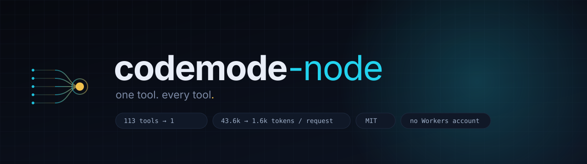
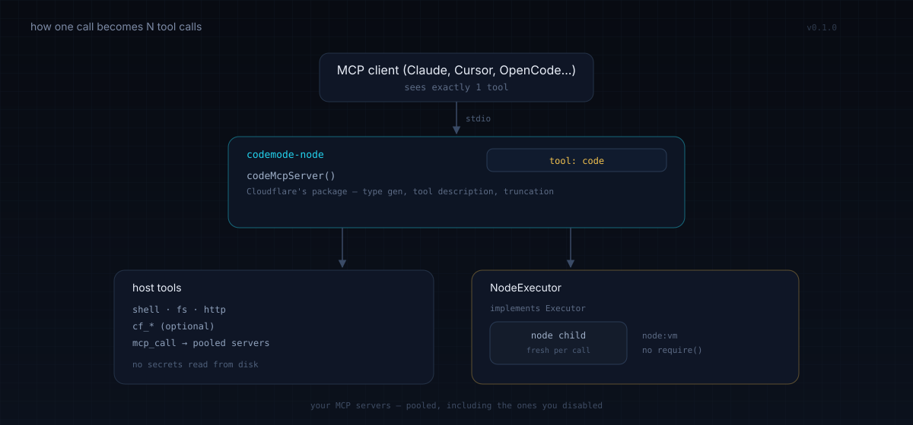

<div align="center">



<br>

[](https://github.com/a-saeedia/codemode-node/actions/workflows/ci.yml)
[](LICENSE)
[](package.json)
[](https://modelcontextprotocol.io)
[](https://github.com/a-saeedia/codemode-node/stargazers)

**Code Mode for Node.** One MCP tool instead of a hundred.<br>
Cloudflare's `@cloudflare/codemode` pattern — without a Cloudflare account.

```bash
npx -y https://github.com/a-saeedia/codemode-node/tarball/main --stats
```

</div>

---

## The 10-second version

Your agent re-reads every tool schema on **every single request**. Eight ordinary MCP servers:



| | tools | schema bytes | tokens / request |
|---|---:|---:|---:|
| 8 MCP servers | 113 | 174,406 | **43,602** |
| codemode-node | 1 | 6,524 | **1,631** |

That's **26.7× less context**, paid once per turn, before the model has done anything. It gets worse with every server you install. In one measured setup, `github` alone was 120 KB.

With Code Mode the model writes one program instead of making one call per step:

```js
const repos = await codemode.fs_glob({ pattern: '*/package.json' });
const stale = [];
for (const f of repos) {
  const pkg = JSON.parse(await codemode.fs_read({ path: f }));
  if (!pkg.description) stale.push(f);
}
return { total: repos.length, stale };
```

Same job. One round trip. A 145-byte answer instead of 41 KB of raw JSON.

## Why this exists

[`@cloudflare/codemode`](https://github.com/cloudflare/agents/tree/main/packages/codemode) turns any MCP server into a single `code` tool. It ships exactly one executor: `DynamicWorkerExecutor`, which needs a Workers `LOADER` binding. A pattern that runs fine on a laptop, gated behind a cloud account.

`Executor` is a public extension point:

```ts
interface Executor {
  execute(code, providersOrFns, options?): Promise<{ result, error?, logs? }>;
}
```

This package implements it on a child process, and wraps the result in a ready-to-use stdio server. Cloudflare still owns the type generation, the tool description, the unwrapping and the truncation — none of that is reimplemented here.

## How it works



The model sees **one** tool. Everything else lives behind it.

## Install

```bash
# audit your current setup first — no install, no config
npx -y https://github.com/a-saeedia/codemode-node/tarball/main --stats

# run the server
npx -y https://github.com/a-saeedia/codemode-node/tarball/main
```

> No publish needed: npm fetches the repo tarball. Once the package is on npm this becomes `npx -y codemode-node`.

<details>
<summary><b>Claude Desktop / Claude Code</b></summary>

```json
{
  "mcpServers": {
    "codemode": { "command": "npx", "args": ["-y", "https://github.com/a-saeedia/codemode-node/tarball/main"] }
  }
}
```
</details>

<details>
<summary><b>OpenCode</b></summary>

```jsonc
{
  "mcp": {
    "codemode": {
      "type": "local",
      "command": ["npx", "-y", "https://github.com/a-saeedia/codemode-node/tarball/main"],
      "enabled": true
    }
  }
}
```
</details>

<details>
<summary><b>Cursor / VS Code</b></summary>

Same shape as Claude Desktop, under `servers` in `.vscode/mcp.json` or `mcpServers` in `.mcp.json`.
</details>

Then turn off the servers you no longer want advertised. **They stay reachable** through `codemode.mcp_call({ server, tool, args })` — disabled means "not advertised", not "unavailable".

## The audit

`--stats` reads your real config, boots each server, and measures the schemas you are actually shipping to the model:

```
  server                    tools     bytes   tokens
  ----------------------------------------------------------------------------
  · higgsfield                 48    182757    45689  ██████████████████████████████
    github                     44    120572    30143  ████████████████████
    director                   26     19725     4931  ███
  · playwright                 24     18502     4626  ███
  ...
  ----------------------------------------------------------------------------
  TOTAL POOLED                282    441280   110320

  · = not advertised (still reachable through codemode.mcp_call)

  ADVERTISED: 113 tools, 174,406 bytes ≈ 43,602 tokens
  WITH CODEMODE: 1 tool ≈ 1,631 tokens
```

`--stats --json` for machines.

## Sandbox API

Every function takes a single object and returns JSON. Available as one `codemode` namespace inside the sandbox.

| group | functions |
|---|---|
| shell / files | `shell`, `fs_read`, `fs_write`, `fs_append`, `fs_exists`, `fs_stat`, `fs_list`, `fs_glob`, `fs_grep`, `fs_remove`, `fs_mkdir` |
| network | `http`, `http_json` |
| MCP | `mcp_list`, `mcp_tools`, `mcp_call` — any pooled server |
| Cloudflare | `cf_get`, `cf_post`, `cf_patch`, `cf_put`, `cf_del`, `cf_request` — only when `CLOUDFLARE_API_TOKEN` is set |
| Moli | `moli_fetch` — only when `MOLI_BIN` is set |
| globals | `sleep(ms)`, `env`, `ROOT`, `log()` |

Return a small summary. **Anything you don't return is discarded** — that's the entire point. `console.log` is captured but never sent back, so put progress in the returned value.

## Config

Auto-discovers the first of:

1. `--config <path>` or `CODEMODE_CONFIG`
2. `./.mcp.json`
3. `~/.config/opencode/opencode.jsonc` (and the Windows path)
4. Claude Desktop config, all three platforms

Understands `mcpServers` (Claude), `mcp` (OpenCode), `servers` (VS Code), including JSONC comments and `{env:VAR}` interpolation.

```bash
npx -y https://github.com/a-saeedia/codemode-node/tarball/main --print-config   # what did it find?
```

| env | effect |
|---|---|
| `CODEMODE_ROOT` | base dir for relative fs paths (default: home) |
| `CODEMODE_TIMEOUT_MS` | sandbox wall-clock limit (default 120000) |
| `CODEMODE_DEBUG=1` | forward pooled-server stderr |
| `CLOUDFLARE_API_TOKEN`, `CLOUDFLARE_ACCOUNT_ID` | enables `cf_*` |
| `MOLI_BIN` | enables `moli_fetch` |

## Security

Read this before pointing it at anything you don't trust.

- Each call runs in a **fresh Node child process** that exits afterwards. No state carries over.
- The sandbox is `node:vm` with **no** `require`, `import`, `process`, or filesystem. Its only capabilities are the proxies listed above.
- **`node:vm` is not a security boundary.** A determined escape exists, and the host functions really do things: `shell` is a shell, `fs_write` writes, `http` reaches the network.
- The model can therefore do **anything you could do in a terminal.** That is the same deal every coding agent makes. If you need a real boundary, run it inside a container.

No secrets are read from disk. Credentials come from the environment only.

## Limitations

- **No streaming.** One result, at the end. Long jobs look like a hang.
- **Plain JavaScript.** No TypeScript, no imports.
- **`console.log` is dropped** by the wrapping package — return your progress.
- Cold start ~1.5 s, then ~250–500 ms per call (child spawn + IPC).
- stdio only on the server side; upstream servers can be stdio or HTTP.

## Benchmarks

Same task both ways, 3 runs, median, Windows 11 / Node 22:

| | round trips | payload to model | tokens | local wall |
|---|---:|---:|---:|---:|
| 5 discrete tool calls | 5 | 41,812 B | 10,453 | 2,240 ms |
| one `code` call | **1** | **145 B** | **36** | 2,733 ms |

The `code` path is ~0.5 s slower locally and **288× smaller** in what reaches the model. Each avoided round trip is a full model call, so end-to-end it wins by seconds per task.

## What this is not

- **Not a new protocol.** It's Cloudflare's package with the missing executor.
- **Not a sandbox vendor.** It's capability isolation, not a jail.
- **Not for Workers.** If you're on Cloudflare, use `DynamicWorkerExecutor` — a real isolate, strictly better than this.

## Related

- [`@cloudflare/codemode`](https://github.com/cloudflare/agents/tree/main/packages/codemode) — the pattern, the Workers executor, the type generator.
- [`universal-tool-calling-protocol/code-mode`](https://github.com/universal-tool-calling-protocol/code-mode) — protocol-agnostic Code Mode (MCP + OpenAPI + native tools).

## License

MIT © [Arman Saeedi](https://github.com/a-saeedia)
